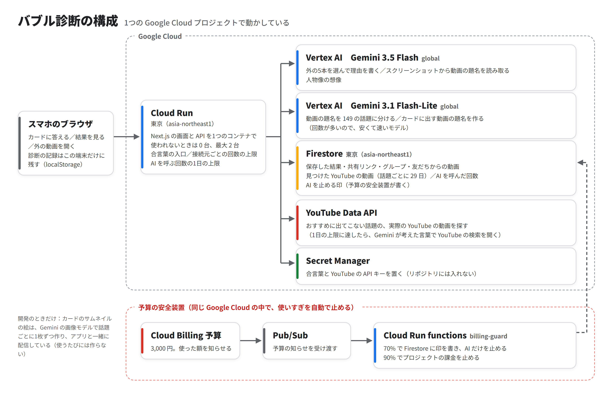

# BubbLens（チーム 黒はんぺん）

DevFest GDGoC Japan Hackathon 2026 の提出物です。デモ動画の一部の画面と構成図には、以前の呼び名「バブル診断」が残っています。

**あなたの YouTube のおすすめに、一度も出てこない話題はいくつ？**
カードに約1分答えるだけで、149 の話題のうち、自分のおすすめに一度も出てこない話題の数がわかる Web アプリです。好きな話題とつながる「出てこない話題」を Gemini が理由つきで5つ選び、実際の YouTube の動画をそのまま見られます。1週間後にもう一度調べると、おすすめが変わったかを前回と比べられます。

- アプリ：https://bubble-web-547073661893.asia-northeast1.run.app（登録も合言葉も要りません）
- カテゴリ：エンターテインメント

## 見どころ（デモ動画の時刻と、コードの場所）
デモ動画は、プロダクト紹介とアプリの流れだけを説明する約2分17秒の動画です。

| 見るところ | デモ動画の時刻 | アプリ・コードで確かめる場所 |
|---|---|---|
| Gemini が働く所 | 1:23 人物像の想像、1:30 外の5本（Gemini が理由つきで選ぶ） | 結果の「外の5本」「人物像」／`web/lib/gemini.ts`、`web/app/api/outside/route.ts` |
| アプリの流れ | 0:34〜 公開中のアプリの録画（カード → 予想 → 結果 → 外の5本 → 記録 → 共有） | 下の「試し方」 |
| 気づきと共有 | 1:02 予想とのずれ、1:58 結果を友だちに送る、2:07 グループで比べる | 結果のスライド（`web/components/result-story.tsx`）、`web/app/group` |
| 技術を選んだ理由 | 動画にはなし（プレゼンスライドの8〜10枚目） | 下の「構成」の表 |
| 安全と保守 | 動画にはなし | 下の「安全のための仕組み」「テスト」、`.github/workflows/check.yml` |
| 課題と根拠 | 動画にはなし（プレゼンスライドの2〜5枚目） | プロダクト説明ドキュメント 2 |

## 試し方（約2分）
1. トップの「例の結果を見る」を押す（カードに答えずに、見本の人の結果を見られる）。自分で試すときは「診断をはじめる」。
2. 一度も出てこない話題がいくつあるかを、つまみで予想する。
3. 約1分のスライドで結果を見る：一度も出てこない話題の数と予想とのずれ → よく出る話題 → 出てこない話題の例 → AI が想像した「YouTube に見えていそうな人物像」 → AI が理由つきで選んだ外の5本 → まとめ。
4. 外の動画を開いて「見た」を押すと、地図に緑の点が加わり、記録に残る。

## 構成


スマホのブラウザ → Cloud Run（Next.js）→ Vertex AI（Gemini 3.5 Flash・Gemini 3.1 Flash-Lite）／Firestore／YouTube Data API。秘密の値は Secret Manager。予算の安全装置は Cloud Billing の予算 → Pub/Sub → Cloud Run functions（`ops/billing-guard`）で、使った額の 70% で AI を止め、90% で課金を止める。

| Google の技術 | 使いどころ | 選んだ理由 |
|---|---|---|
| Gemini 3.5 Flash | 外の5本を選んで理由を書く／人物像の想像／スクリーンショットの読み取り | ルールでは書けない「つながり」と「読み取り」 |
| Gemini 3.1 Flash-Lite | 動画の題名を 149 の話題に分ける／カードの題名 | 回数が多いので、安くて速いモデル |
| Cloud Run | アプリ全体 | 使われないときは0台まで減る。コンテナで Next.js をそのまま動かせる |
| Firestore | 保存した結果・比較・共有リンク・見つけた動画（29日）・AI の回数 | サーバーの管理がいらず、サービスアカウントの権限で読み書きできる |
| YouTube Data API | 出てこない話題の実際の動画 | 本物の動画で、外への1歩をそのまま踏み出せる |

数字と説明文はプログラムで計算し、Gemini は呼びません（速く・毎回同じ・安い）。

## 安全のための仕組み
- 回数の上限：同じ接続元から10分に AI 60回・API 300回・合言葉の入口 30回（`web/lib/rate-limit.ts`）
- AI の1日の上限（1500回）と、同じ答えの覚え置き（`web/lib/ai-guard.ts`）
- YouTube の上限：見つけた動画は話題ごとに29日覚え、無かった話題は1日覚えて候補から外す。上限のときは、Gemini の言葉で YouTube の検索を開く（`web/lib/youtube.ts`）
- 動画の題名・答えは保存しない（保存するのは本人が「保存して比べる」を押したときの数字と話題の名前だけ）。API キーはリポジトリに置かない
- データベースは Firestore で、SQL は使わない。外から来た ID は、Firestore が作る形（英数字20文字）のときだけ使う（`web/lib/db.ts`）

## 動かし方
```bash
cd web
pnpm install
cp .env.example .env.local   # Google Cloud のプロジェクトと YouTube の API キーを入れる
pnpm dev
```

## テスト
```bash
cd web
pnpm test        # vitest 21本（主役の数の出し方・推定・共有の中身・回数の上限・動画の覚え方・ID の形・Gemini の返事の検査）
pnpm lint
```
開発用のリポジトリでは、GitHub Actions（`.github/workflows/check.yml`）で、push のたびに型・lint・テストを確かめています。この提出用リポジトリでは Actions は動きません。

## フォルダ
| 場所 | 中身 |
|---|---|
| `web/app` | 画面と API（Next.js App Router） |
| `web/lib` | 数の出し方（feed-metrics・estimate）、Gemini（gemini.ts）、YouTube（youtube.ts）、Firestore（db.ts） |
| `web/components` | 結果のスライド（result-story.tsx）など |
| `web/tests` | 自動テスト |
| `ops/billing-guard` | 予算の安全装置 |

## このリポジトリについて
開発は別の開発用リポジトリ（非公開）で進め、最終版をここに置いています。コードを書きはじめたのは、開発開始（11/5 10:00）のあとです。

## ライセンス
[MIT License](LICENSE)
